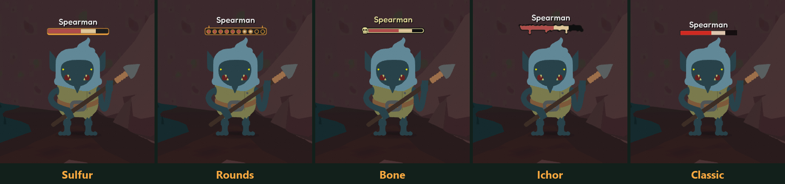
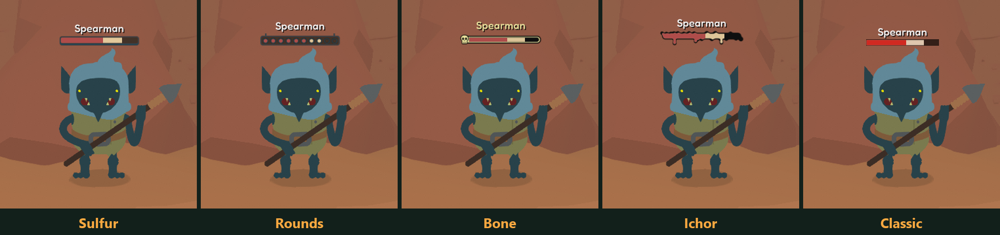
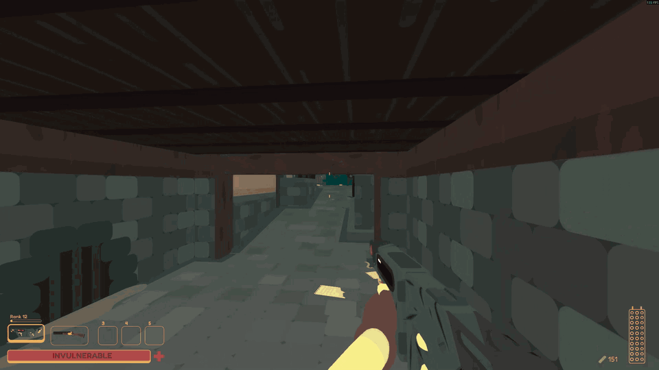

# Enemy Health Bars

Standalone enemy health bars for SULFUR, a BepInEx 5 plugin. The player docs are in [Thunderstore/README.md](Thunderstore/README.md).

## Bar styles

All five styles, caught right as an enemy takes a hit. The red part is the health left, and the pale part is what that hit just took off.



Sulfur and Rounds follow the game's UI color, so they change with the HUD in areas like the desert.



## In combat



## [Watch clips of every style on GitHub](https://github.com/ryuka-dev/Enemy-Health-Bars/blob/main/docs/GALLERY.md)

8 more clips, including each style and a few other fights. They're GIFs of 3 to 18 MB each, about 76 MB in total, so the page can take a while on a slow connection.

## Design

- `HealthBarManager` owns the overlay canvas, the bar pool and the per-enemy cache. It reads `GameManager.aliveNpcs` every 0.1 s and notices damage by comparing `normalizedHealth`. That works the same on a co-op client, where hits from other players do not run the local damage path.
- `EnemyRules` decides which units may carry a bar. Checks that can change run every frame while a bar is showing.
- `BossBarTracker` follows `BossHealth.Attach` and `Detach`, because the boss bar can follow a unit that is not flagged as a boss. These are the only Harmony patches.
- `HealthBarView` is one pooled bar. It holds no game references.
- `BarStyle` describes a look. Sprites are embedded in the DLL and generated by `art/generate_styles.py`, which also writes `src/BarArt.generated.cs` so the fill range lives in one place. The layers of a style share one size, so views need no per-style layout.

- Team marks (SULFUR Together combat API 2): while other players have their mark on an enemy, its bar shows it, one per player, in each style's own form. `HealthBarIntegration` is the mod's public surface for this and names no other mod's types. The skull in the marks is cut at run time from the game's portrait of the Black Guild skeleton (`SkullArt`, the recipe SULFUR Together uses), so no game art ships; the rest of each mark is generated with the bar art.
- `SulfurTogetherAdapter/` is a separate plugin in the same package (`EnemyHealthBars.SulfurTogether.dll`), with hard dependencies on this mod and on SULFUR Together, so BepInEx skips it when SULFUR Together is absent. It is the only code that names `SULFURTogether.Api` types, keeps them out of every field, and calls API 2 members only after checking `NetCombat.ApiVersion`. It reads the mark count, refreshes on `MultiplierChanged`, and registers a mark presenter: while a bar shows an enemy's marks, SULFUR Together does not draw its own icon over that enemy, and a bar that is hidden, out of range or fading hands the marks back to the icon.

The mod changes no gameplay state.

The game hides enemies in several unrelated ways, and each needs its own check: `isInvisible`, `Npc.HiddenMode`, `Unit.Targetable`, `HellShrewSnipa.IsHidden`, a deactivated `mainRenderer` (pike riders), and the private `unitOpacity` pair on `Npc`, which is the only record of a ghost fading out.

## Build

Paths come from `Directory.Build.props` and can be overridden on the command line.

```text
dotnet build "Enemy Health Bars.csproj" -t:Restore;Compile -v:m -nologo
```

Deployment is off by default. Pass `-p:DeployToSulfurProfile=true` to a full build to copy the plugin into the configured Gale profile.

The SULFUR Together adapter compiles against `$(SulfurTogetherDir)\bin\Release\net472\SULFUR Together.dll`, so that build has to exist first. `Enemy Health Bars.slnx` builds both plugins; give it to the packaging script, since the repository now holds two projects. The adapter is only staged into `Thunderstore/`; a profile deploy of the mod does not copy it.

## License

MIT. See [LICENSE](LICENSE).
