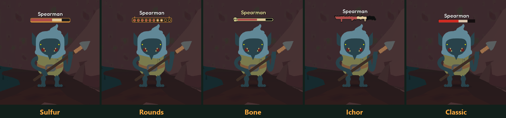
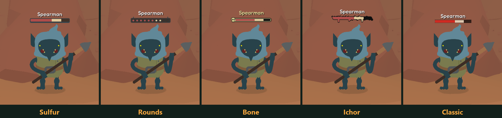
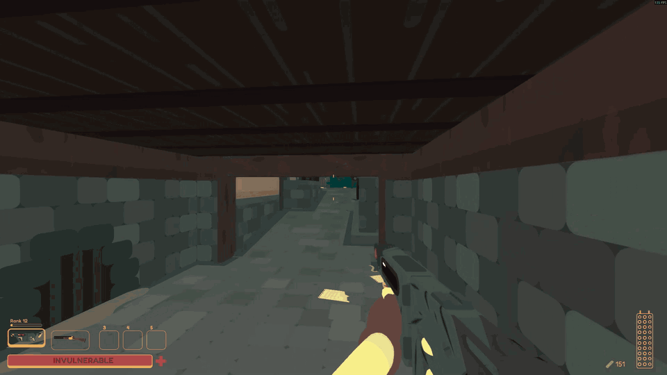

# Enemy Health Bars

Standalone health bars for enemies in SULFUR. Hit an enemy and a bar shows up above it for a few seconds.

It's display only, so damage, stats and loot stay the same.

## Bar styles

All five styles, caught right as an enemy takes a hit. The red part is the health left, and the pale part is what that hit just took off.



Sulfur and Rounds follow the game's UI color, so they change with the HUD in areas like the desert.



## In combat



## [Watch clips of every style on GitHub](https://github.com/ryuka-dev/Enemy-Health-Bars/blob/main/docs/GALLERY.md)

8 more clips, including each style and a few other fights. They're GIFs of 3 to 18 MB each, about 76 MB in total, so the page can take a while on a slow connection.

## How it behaves

- A bar shows up when an enemy loses health and fades about six seconds after the last hit.
- You need a clear line of sight, so enemies behind walls have no bar.
- Enemies the game is hiding stay hidden. That covers invisible enemies, disguised ambushers and faded-out ghosts.
- Bosses keep their normal boss bar and don't get a second one.
- Allies, charmed enemies, shopkeepers and other friendly characters have no bar.
- Bars hide in menus and the inventory, during dialogue and cutscenes, and on the death screen.
- Enemy names follow your game language.

## Settings

Change these in `BepInEx/config/ryuka.sulfur.enemy_health_bars.cfg`, or in game through SULFUR Config if you have it installed.

### Display mode

```ini
[Display]
DisplayMode = Damaged
```

**Damaged** shows bars only on enemies that lost health. **Nearby** shows bars on every enemy you can see in range, up to 32 at once, nearest first.

### Bar style

```ini
[Display]
BarStyle = Sulfur
```

**Sulfur** matches the HUD health bar and follows its color. **Rounds** is a row of ten rings like the ammo gauge. **Ichor** is a bar of dripping ink. **Bone** has a skull at its left end. **Classic** is a plain bar.

### Max distance

```ini
[Display]
MaxDistance = 30
```

How far away a bar can still show, in meters (5 to 100).

### Bar scale

```ini
[Display]
BarScale = 1
```

Size of the bars and names (0.5 to 2).

### Show name

```ini
[Display]
ShowName = true
```

Shows the enemy's name above its bar.

## Compatibility

- Needs only BepInEx. SULFUR Config is optional.
- **Battle Improvements** has an enemy health bar too. If you run both, turn its bar off (`EnableHealthBar`) or each enemy shows two.
- Works with Damage Sparks.
- SULFUR Together: bars are local to your game. If you join someone else's session, bars follow the health the host sends, so they can lag a little, and enemies that stay invisible until they notice you may not get a bar.

## Issues

Report problems at https://github.com/ryuka-dev/Enemy-Health-Bars/issues.
