# Gallery

All 9 clips are GIFs recorded in game, about 92 MB in total. Each one lists its size in case you're on a slow connection.

## Bar styles

All five styles, caught right as an enemy takes a hit. The red part is the health left, and the pale part is what that hit just took off.

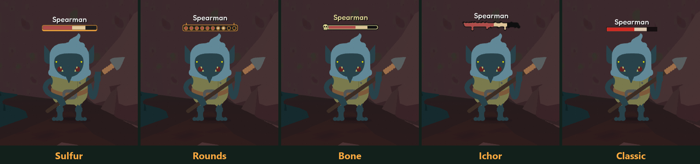

Sulfur and Rounds follow the game's UI color, so they change with the HUD in areas like the desert.

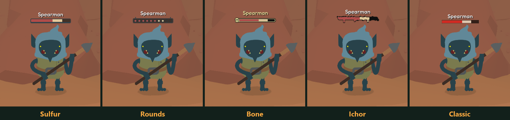

## Sulfur

**`sulfur-spearmen.gif`** (5.9 MB)

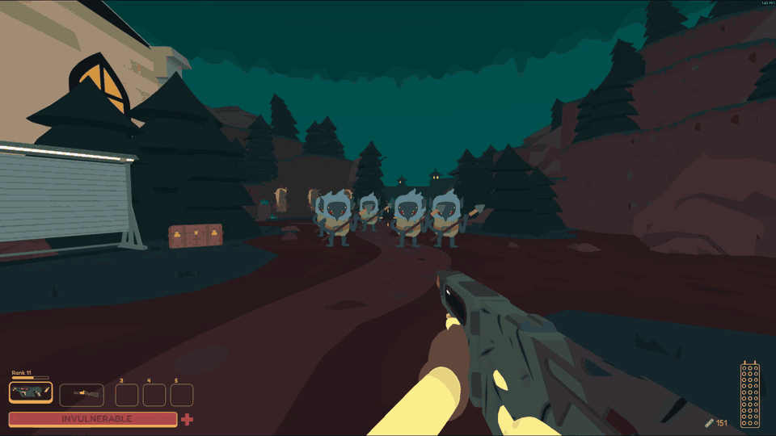

**`sulfur-barrel-boy.gif`** (3.3 MB)

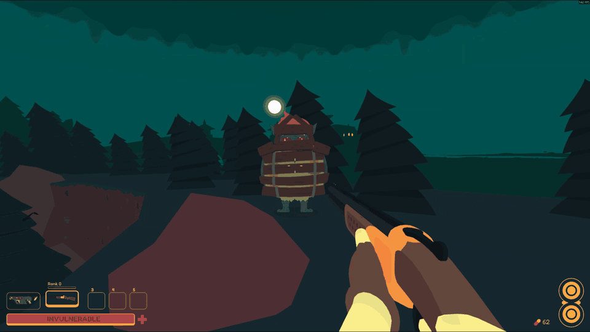

## Rounds

**`rounds-spearmen.gif`** (5.2 MB)

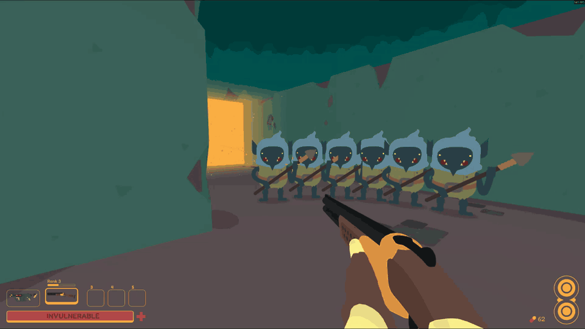

## Bone

**`bone-spearmen.gif`** (10.2 MB)

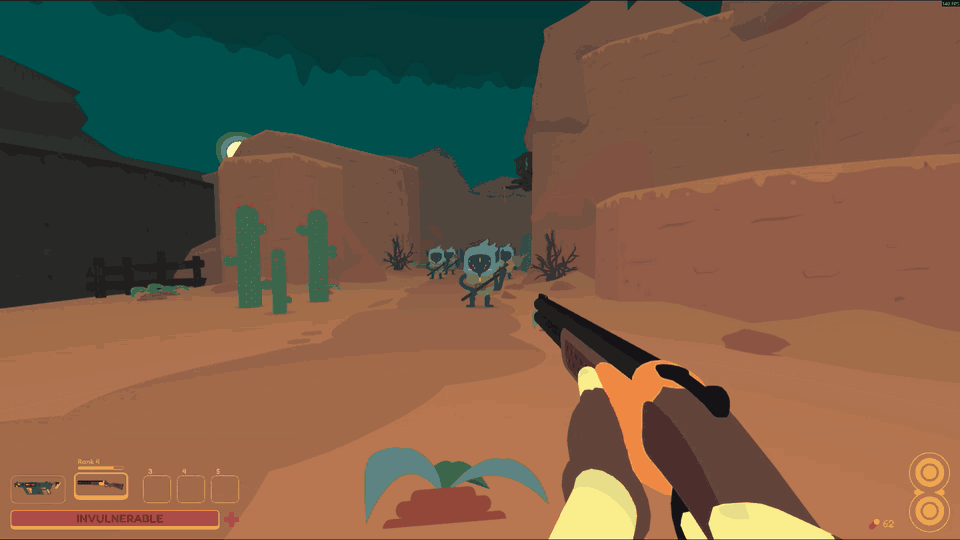

## Ichor

The first enemy dies in one shot, so it never gets a bar.

**`ichor-spearmen.gif`** (8.9 MB)

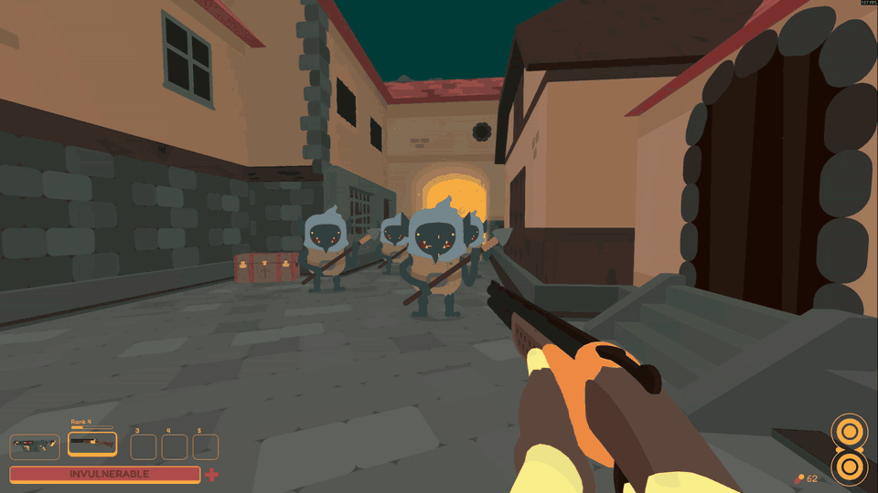

## In combat

**`sulfur-combat-1.gif`** (13.1 MB)

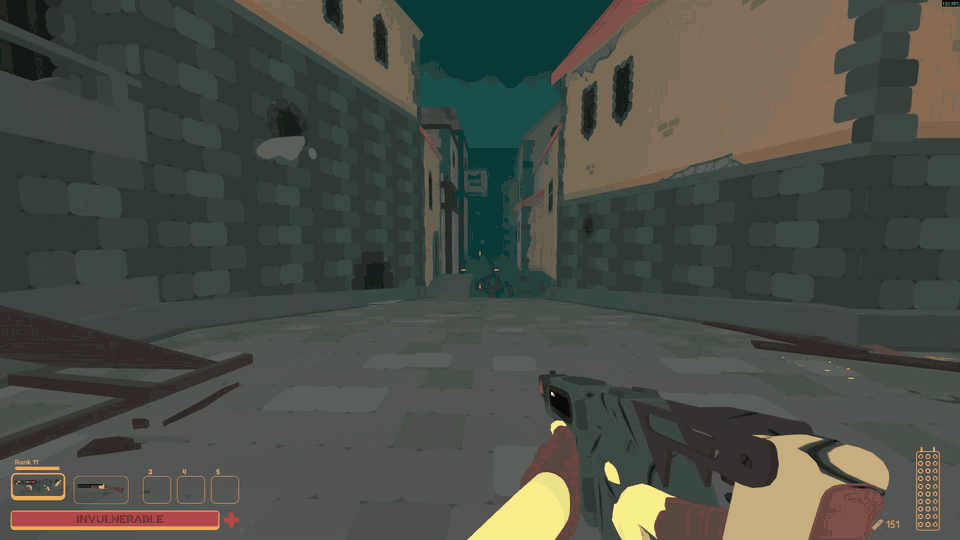

**`sulfur-combat-2.gif`** (16.0 MB)

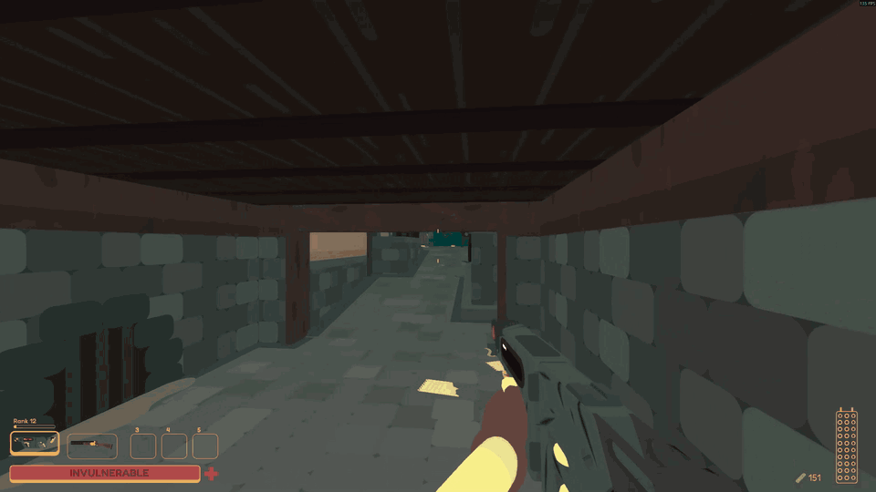

**`sulfur-combat-3.gif`** (11.2 MB)

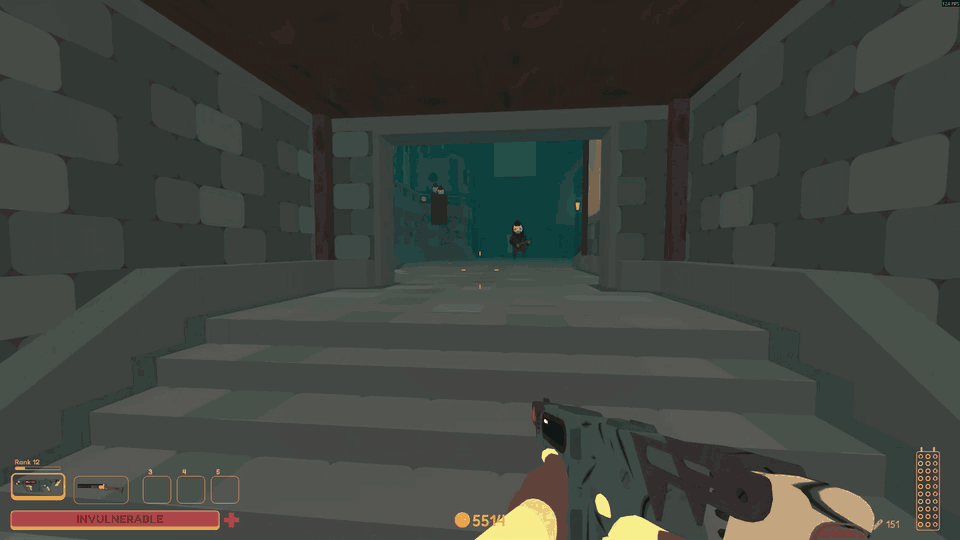

**`classic-combat.gif`** (18.2 MB)

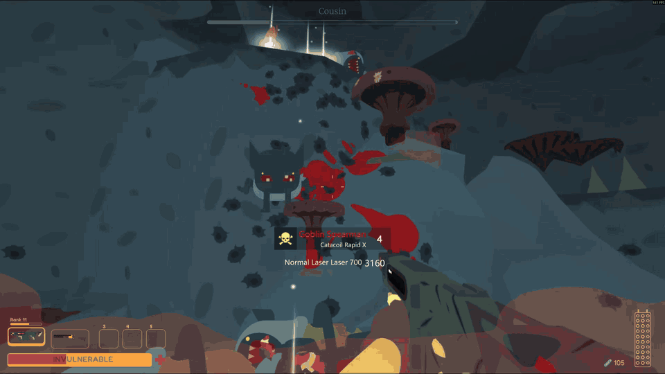
